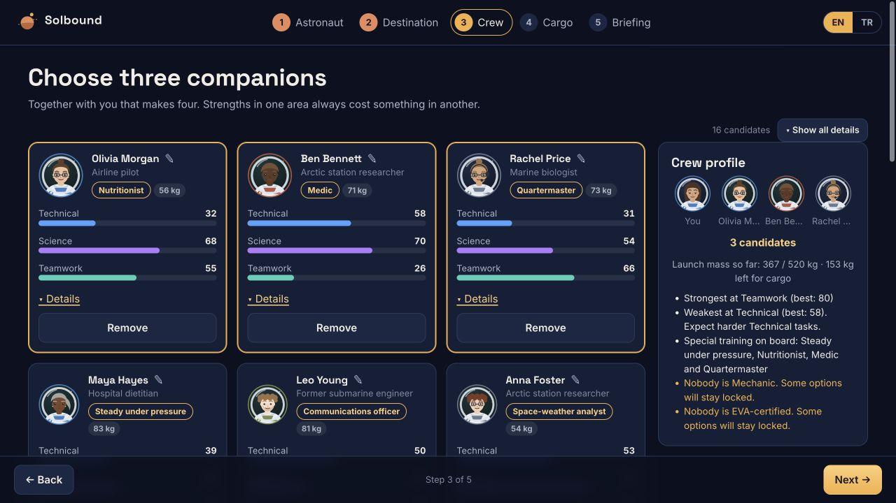
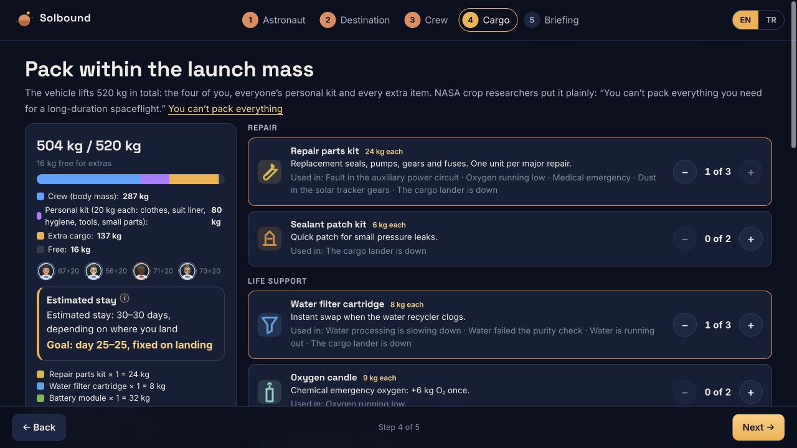

<div align="center">
  
  <h1>Solbound</h1>
  <p><strong>Choose your crew. Pack every kilo. Bring everyone home.</strong></p>
  <p>
    <a href="https://solbound.vercel.app"><strong>▶ Play now</strong></a> ·
    <a href="https://www.youtube.com/watch?v=k4y-1OFfU08">Watch the trailer</a> ·
    English / Türkçe
  </p>
  <a href="https://www.youtube.com/watch?v=k4y-1OFfU08">
    
  </a>
</div>

## About

Solbound is a story-driven survival game set on the **Moon or Mars**. You lead a four-person crew through a 30-day surface mission, keeping **oxygen, water, power, food and radiation shielding** in balance. Every decision has a cost.

The solar storms are real: solar eruptions recorded in **NASA DONKI** become radiation events in your mission, with the real dates and speeds shown in the game.

## How it plays

| | |
| --- | --- |
| **1. Choose your crew** | Pick three companions from sixteen. Each has different skills and a different personality. |
| **2. Pack for launch** | You have 520 kg, and that includes the crew's own body mass. |
| **3. Survive 30 days** | Deal with dust storms, meteor showers, quakes, failing systems and arguments in the crew. Big events come with a countdown, so you can prepare. |
| **4. Bring them home** | Book the return window, get everyone off the surface and share a recap film of your mission. |

|                        Build your crew                        |                     Pack for survival                     |
| :-----------------------------------------------------------: | :-------------------------------------------------------: |
|  |  |

## Run locally

Requires Node.js 20.19+.

```sh
npm install
npm run dev     # start the game
npm test        # engine tests
```

Built with React, TypeScript and Vite. Design notes and science sources are in [`docs/`](docs/README.md).

---

<div align="center">
  Built by <strong>LoversGG</strong> for the <strong>METU NASA Space Apps Challenge 2026</strong>. An independent student project, not an official NASA product.<br />
  <a href="LICENSE">MIT License</a> · <a href="docs/media/CREDITS.md">Media credits</a>
</div>
