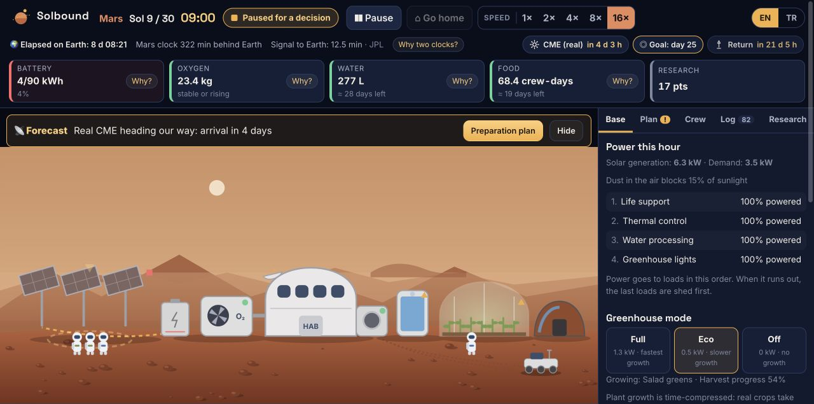
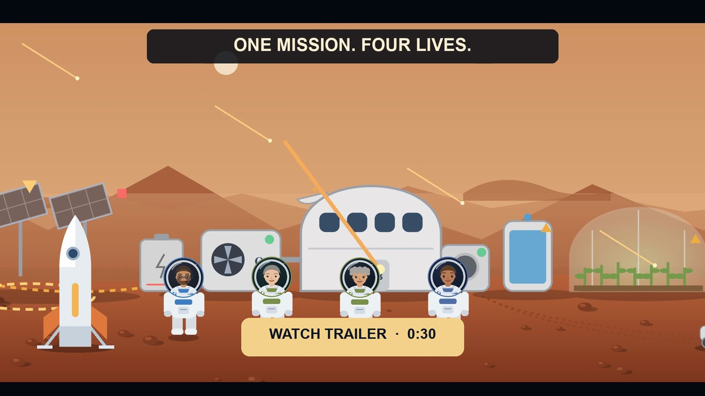

<div align="center">
  
  <h1>Solbound</h1>
  <p><strong>Choose your crew. Build your outpost. Bring everyone home.</strong></p>
  <p><a href="https://solbound.sigma.app"><strong>Play now ↗</strong></a> · <a href="docs/media/solbound-trailer.mp4">Watch the trailer</a> · English / Türkçe</p>
</div>



A story-driven STEM survival game set on the **Moon or Mars**. Recruit three companions, pack for launch, and balance **oxygen, water, power, food and radiation protection** through a 30-day mission. Real **NASA DONKI space-weather records** shape the challenges your crew faces.

| Build your crew | Pack for survival |
| :---: | :---: |
|  |  |

## Trailer

[](docs/media/solbound-trailer.mp4)

## Run locally

Node.js 20.19+.

```sh
npm install
npm run dev
```

React · TypeScript · Vite

---

Built by **LoversGG** at **METU NASA Space Apps Challenge 2026**. Independent student project.

[MIT License](LICENSE) · [Media credits](docs/media/CREDITS.md)
