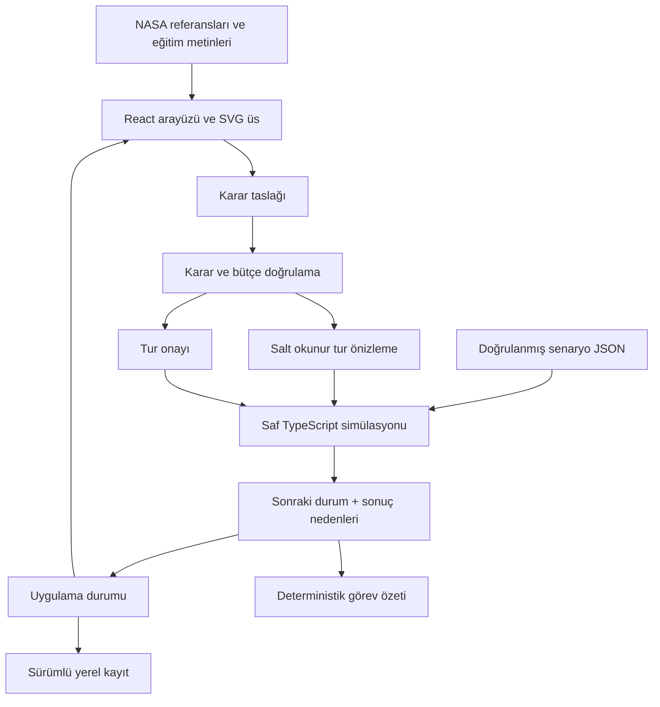

> Tarihsel v0.1 önerisi. Güncel kapsam için [v0.2 başlangıç belgesini](00_START_HERE.md) okuyun. Bu dosyadaki 12-sol, yalnız Mars, yalnız tur onayı veya araştırma-only kapsamı güncel gereksinim değildir. Bilimsel/teknik ayrıntılar güncel belgelerle birlikte değerlendirilir.

# Teknik mimari — öneri v0.1

## Karar

Hackathon için tek tarayıcı uygulaması ve dış servislerden bağımsız, deterministik bir simülasyon. İlk hedef masaüstü tarayıcı; tablet boyutlarında uyarlanan arayüz. React + TypeScript + Vite önerilir. Görsel üs SVG/CSS ile kurulur; oyun motoru ve WebGL ilk sürüm için gerekli değil.

Bu belge bir scaffold veya kurulu teknoloji beyanı değildir. Sürümler, paket lisansları ve hedef tarayıcı desteği uygulama başlarken doğrulanır.



## Modül sınırları

| Alan | Sorumluluk | Bağımlılık kuralı |
| --- | --- | --- |
| `src/domain/` | State, action, result ve senaryo tipleri | React ve tarayıcı API'si içermez |
| `src/simulation/` | Kaynak akışları, olaylar, sağlık ve görev sonucu | Yalnızca domain ve verilen senaryo |
| `src/content/` | Mars senaryosu, modüller, olaylar, kaynak kayıtları | Veri + şema doğrulama |
| `src/features/mission/` | Karar taslağı, tur onayı, görev yaşam döngüsü | Tek motor girişini çağırır |
| `src/features/outpost/` | SVG üs ve modül etkileşimi | State okur; hesap kopyalamaz |
| `src/features/debrief/` | Açıklamalar, karar geçmişi, karşılaştırma | Motorun ürettiği delta ve nedenleri |
| `src/state/` | İnce store; gerekirse Zustand | Simülasyon matematiğini içermez |
| `src/persistence/` | Kayıt yükleme, doğrulama, sürüm geçişi | localStorage erişimini izole eder |
| `src/ui/` | Ortak erişilebilir bileşenler | Domain kurallarına karar vermez |
| `tests/` | Senaryo ve uçtan uca kontroller | Sabit tohum ve doğrulanmış fixture |

Basit repo yeterlidir; monorepo, mikroservis, veritabanı ve API katmanı MVP için eklenmez. Eğitim içerikleri uygulamayla birlikte paketlenir. Oyun ağ olmadan karar hesaplayabilir; ilk yüklemenin çevrimdışı çalışması için gereken service worker/PWA ayrı bir geliştirmedir.

## Motor sözleşmesi

```ts
type StepInput = {
  state: MissionState;
  actions: TurnPlan;
  scenario: ScenarioDefinition;
};

type StepResult = {
  nextState: MissionState;
  deltas: ResourceDelta[];
  causes: CausalEffect[];
  revealedEvents: MissionEvent[];
  outcome: 'ongoing' | 'success' | 'abort';
};

// Kavramsal sözleşme; henüz uygulama kodu değil.
declare function advanceSol(input: StepInput): StepResult;
```

`MissionState`: `schemaVersion`, `scenarioVersion`, `sol`, `seed`, `rngCursor`, kaynak stokları, modül çalışma durumları, ekip sağlığı/radyasyon risk endeksi, bitki büyüme ilerlemesi, bakım durumu ve karar geçmişi.

`TurnPlan`: sistem çalışma seviyeleri, ekip görevleri ve en fazla bir inşa/yükseltme kararı. Her görevin ekip zamanı, malzeme, güç gereksinimi ve tamamlanma süresi tanımlıdır. Aynı mürettebat iki yerde kullanılamaz.

Motor `Date.now()`, `Math.random()`, DOM, fetch veya store kullanmaz. Girdi değişmez; aynı senaryo sürümü, state ve karar aynı sonucu üretir. PRNG durumu kayıt içinde tutulur.

## Tur işleme sırası

1. Kararları, ekip süresini ve stok maliyetlerini doğrula. Geçersizse state değişmeden yapılandırılmış hata döndür.
2. İnşa/bakım eylemlerinin bu tur maliyetini uygula; yeni modül bir sonraki tur aktif olur.
3. Senaryonun olay takviminden mevcut sol koşullarını belirle; PRNG ilerlemesini yalnızca commit edilen sonraki state'e yaz.
4. Güneş üretimini, kapasiteleri ve batarya erişilebilir enerjisini hesapla.
5. Talebi ilan edilen öncelik sırasıyla karşıla: yaşam desteği → termal/CO₂ kontrolü → su işleme → sera → atölye. Kısmi çalışma katsayılarını uygula.
6. Oksijen/su üretimi ve tüketimi, gıda tüketimi, büyüme ve hasadı hesapla. Su geri kazanımı yalnızca bu tur oluşan uygun atık su havuzundan yapılır.
7. Kalan enerjiyi şarj/deşarj sınırları ve verimlerle bataryaya işle; fazla üretimi kayıp olarak kaydet.
8. Korunma ve görev maruziyetinden radyasyon riskini; açık yaşam desteği eksiklerinden sağlık etkisini hesapla.
9. Bakım/aşınma durumunu güncelle, görev sonunu değerlendir, açıklanabilir değişim kaydı üret, sol sayacını ilerlet.

Her nedensel kayıtta etkilenen kaynak, miktar, kural kimliği ve ilgili olay/modül bulunur. Ekran ve görev özeti aynı kaydı kullanır; neden metni LLM tarafından üretilmez.

## Önizleme ve belirsizlik

Önizleme state'in kopyası üzerinde aynı hesap çekirdeğini kullanır; gerçek PRNG veya kayıt değişmez. Öğrencinin henüz bilmediği olayları açığa çıkarmaz. Bu nedenle iki giriş yolu vardır: `previewSol(knownState, plan, knownConditions)` ve `advanceSol(fullState, plan, scenario)`; ikisi ortak kaynak çözümleyicisini çağırır. Kesin bilinen koşullarda sayılar eşleşir. Bilinmeyen olaylarda önizleme, belirtilmiş varsayım/risk aralığı gösterir; kesin sonuç sözü vermez.

## Birimler ve model bütünlüğü

- Enerji stokları `kWh`; talep/üretim her tur için `kWh/sol`. Anlık güç eklenirse `kW` ayrı tutulur, sol süresiyle dönüştürülür.
- Su `L`, oksijen `kg`, gıda `crew-day` eşdeğeri; dört kişilik bir solun tüketim dönüşümü senaryoda tanımlanır.
- Sağlık ve radyasyon riski açıklanmış boyutsuz eğitim endeksleridir; tıbbi doz/sağkalım tahmini değildir.
- Enerji toplamları, su havuzları ve stok değişimleri hesap defteriyle izlenir; eksik kaynak eksi stok yerine `unmetDemand` üretir.
- Üretim kapasiteleri, batarya şarj/deşarj limitleri, geri kazanım verimi ve hasat gecikmesi veriyle tanımlanır.
- Mars atmosferinden oksijen üretimi eklenirse CO₂ tabanlı ayrı bir ISRU modülü olur. Su elektroliziyle aynı süreç olarak modellenmez.
- Sera, ilk günden tam gıda veya tüm ekip için yeterli oksijen üretmez. 12 solluk görev için kısmi büyümüş bitki veya açıkça belirtilmiş zaman sıkıştırması gerekir.
- Koruma akut parçacık olayı riskini azaltır; tüm uzay radyasyonunu yok ettiği iddia edilmez.

Tüm katsayılar `sourceId`, `kind: sourced | derived | gameplay`, birim ve gerekçe taşır. Bilimsel bağlantılar korunur; denge sayıları doğrulanmış NASA görev parametreleri gibi sunulmaz.

## Kayıt ve gizlilik

Şema ve senaryo sürümüyle doğrulanan bir localStorage kaydı; JSON dışa/içe aktarma sonraki öncelik. Bozuk veya uyumsuz kayıt uygulamayı çökertmez: temiz başlangıç ve açıklayıcı bildirim sunulur. Kayıt yazılamıyorsa görev bellekte sürer ve kalıcılık uyarısı gösterilir. MVP hesap, öğrenci kimliği, sunucu telemetrisi ve API anahtarı istemez.

## Test ve kabul kapısı

- Saf motor: enerji muhasebesi, batarya sınırları, negatif stok olmaması, doğru su geri kazanımı ve gıda hasat gecikmesi.
- Determinizm: aynı seed + karar geçmişi aynı state ve nedenleri üretir.
- Önizleme: state/PRNG değişmez; bilinen olayda commit ile uyumlu; gizli olay sızıntısı yok.
- Denge: en az iki farklı başarılı politika ve açıklanabilir bir başarısız politika aynı demo seed'inde çalışır.
- E2E: göreve başla → birkaç tur oyna → kaydet/yükle → görev sonu → yeniden dene.
- Temel klavye, kontrast ve azaltılmış hareket kontrolü; ekrana sığan tablet görünümü.

CI planı: lockfile ile kurulum → typecheck → motor testleri → production build. E2E çekirdek akış hazır olduğunda eklenir. Dağıtım sağlayıcısı takımın hesabı ve gerçek gereksinimlere göre seçilir; MVP herhangi bir statik host üzerinde çalışabilir.
