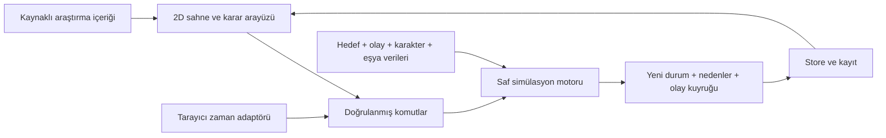

# Oyun sistemleri ve güncel mimari

v0.2. [Ürün kapsamı](archive/00_START_HERE.md) ve [ekran akışı](USER_FLOW.md) ile birlikte okunur. Aşağıdaki sayılar dengelenecek oyun parametreleridir.

## Teknoloji ve sınırlar

React + TypeScript + Vite önerisi korunur. SVG/CSS ile özgün 2D sahneler; gerekirse hafif animasyon kütüphanesi. Saf TypeScript motor, şemayla doğrulanan senaryo/olay verileri, ince store, sürümlü localStorage. Paket sürümleri scaffold sırasında doğrulanır. Backend ve runtime LLM temel akışın gereksinimi değildir.

## Durum makinesi

`language → identity → destination → crew → cargo → briefing → outbound → landing → surface → returnPrep → returnFlight → debrief`

`abort` ve `loss` yalnız izinli aktif görev aşamalarından sonuç ekranına gider. Geri/ileri gezinme hazırlık verisini yeniden üretmez. Kayıt tam aşamayı, açık olayı, çalışan işleri ve zaman ilerlemesini taşır.

| Veri | Temel alanlar |
| --- | --- |
| Run | schemaVersion, contentVersion, runId, seed, rngState, revision, phase, locale, mode |
| Character | id, name, portraitSeed, backgroundId, technical, science, teamwork, traitIds |
| CrewState | characterId, health, stress, experience, status, assignedTaskId |
| Cargo | itemId, quantity, volumePerUnit, remainingUses |
| Mission | destinationId, elapsedMissionMinutes, targetDays, resources, modules, tasks, eventQueue, activeEvent, journal |
| Decision | id, eventId, optionId, assignedCrewIds, resolvedAt, costs, effects, causalFacts |

İsim ve dil kimliği değiştirmez. Lokalizasyon değişimi seed'i, özellikleri veya olay sonucunu değiştirmez. Bilgi/deneyim gelişimi tamamlanan işlemlere bağlıdır; butona tekrar basarak artmaz.

## Rastgelelik ve yetenek

- Tek seed'den ayrı karakter, olay ve sonuç akışları türet; portre veya UI render'ı olay şansını değiştirmesin.
- Adaylar ortak bir yetenek bütçesi ve uzmanlaşma dağılımı kullanır; her durumda en iyi tek aday olmasın.
- Kaynak maliyetleri ve bilinen üretim deterministiktir. Belirsiz görevlerde risk, ekip yeteneği, yorgunluk, ekipman ve olay zorluğuna bağlanır.
- İlk deneme formülü: `p = clamp(base + skillFit + equipmentBonus - fatiguePenalty - hazardPenalty, min, max)`. Değerler oyun varsayımı etiketi taşır; olasılık NASA verisi gibi sunulmaz.
- Sonuç çekilişi yalnız karar commit edilirken yapılır. Önizleme, hover ve kayıt yenileme yeni zar atmaz.
- Başarısızlığın maliyeti tanımlıdır: zaman kaybı, parça tüketimi veya hasar. Her başarısız iş otomatik ölüm değildir.

## 100V yük ve kaynaklar

Envanter hacmi `sum(quantity × V) ≤ 100`; miktarlar tam sayı ve negatif olamaz. V soyut kapasitedir; kütle/denge ayrı gelecekteki kısıttır. İleride ikisi modellenirse ayrı birimlerle tutulur.

Başlangıç üssü asgari çalışır altyapı ve açıkça gösterilen rezervleri sağlar. Kargo iyileştirme, yedekleme ve uzman seçenekler içindir. Batarya enerji üretmez; kapasite sağlar ve başlangıç doluluğu açıkça belirtilir.

Örnek, dengelenmemiş yük verisi: yedek filtre 10V, parça kiti 15V, gıda paketi 10V, batarya modülü 20V, sera kiti 20V, koruma kiti 25V. Hepsinin toplamı 100V'yi aşar; başka kombinasyonlar denenir. Eşya etkisi adı kadar açık olmalı; “koruma kiti” bütün radyasyonu engellemez.

Enerji kWh, su L, oksijen kg, gıda crew-day eşdeğeri; bütün oranlar zaman aralığıyla tutarlı dönüştürülür. Sağlık/stres/radyasyon risk endeksleri eğitim amaçlı boyutsuz değerlerdir. Negatif stok yerine karşılanamayan talep kaydı üretilir. Elektroliz su tüketir; geri kazanım yalnız oluşan uygun atık sudan yapılır. Sera üretimi gecikmelidir ve zamanı sıkıştırılmışsa arayüz bunu söyler.

## Saat ve olayların sırası

Tarayıcı adaptörü geçen aktif süreyi mantıksal adımlara çevirir. Saf motor saat okumaz; `advanceTime(state, deltaMissionMinutes, scenario)` çağrılır. Önerilen sabit adım bir görev saatidir; bir adım sınırına kadar kalan süre de saklanır. Düşük FPS daha fazla veya daha az kaynak üretmez.

Sıra: sıradaki zaman eşiğine kadar ilerle → görev tamamlanmalarını ve kaynakları işle → sağlık/toleransları değerlendir → uygun olayları sıraya koy → kritik olayda dur → kalan zamanı ancak olay çözüldükten sonra işle. Büyük zaman adımı bütün olayların üstünden atlayamaz. Aynı eşikte sıralama veriyle sabittir; çözülen event ID tekrar açılmaz.

`resolveDecision(state, eventId, optionId, crewIds)` uygunluğu ve maliyeti doğrular, tek sefer uygular, nedeni kaydeder. Uzun işler için maliyet başlangıçta, tamamlanma etkisi iş bitiminde uygulanır; kuyruklanan seçenek gelecekteki etkiyi hemen kazanmaz. Ekip aynı anda iki işte olamaz. Sığınaktaki biri dış görev yapamaz.

Saat gizli sekmede durur. Kaydı açınca `Date.now() - savedAt` kadar simülasyon ilerletilmez. Karar/araştırma duraklaması ile oyuncunun manuel duraklaması ayrı nedenlerdir; panel kapatmak manuel duraklamayı kaldırmaz.

## Hedef ve yaşam desteği modeli

Ay ve Mars ayrı `ScenarioDefinition` kullanır: olay havuzu, çevre koşulları, üs görünümü, başlangıç rezervleri, araştırma içeriği ve görev hedefi. Ay için Mars toz fırtınası kartı kullanılmaz. Ayda uzun gece/konum ilişkisi, Marsta toz/ışık ilişkisi kaynağa göre açıklanır; ayrıntılı fizik ilk sürümde soyutlanabilir.

Güç önceliği yaşam desteği, termal/CO₂ kontrolü, su, sera, atölye olarak görünür ve oyuncu stratejisiyle yönetilir. Kısmi güç modül verimini etkiler. Batarya şarj/deşarj sınırı ve kaybı vardır. Korunma, dış görev süresi ve olay türü radyasyon riskini etkiler; tüm risk sıfırlanmaz.

Sağlık bozulması kaynak açığının süresiyle ilişkilidir. Akut oksijen açığı ile gıda açlığı aynı süre veya sonuçla modellenmez. Kurtarma penceresi, risk uyarıları ve müdahale olanağı gösterilir. Radyasyon endeksi tıbbi doz/gerçek insan sağkalım tahmini değildir. `deceased` durumu yalnız açıklanmış kural zincirinden doğar; rastgele sürpriz ceza olmaz. Bu durumları yaş düzeyine uygun anlatmak için keşif modunda tahliye karşılığı önerilir.

## Araştırma, veri ve opsiyonel AI

Araştırma kartı: `claim`, `sourceUrl`, `sourceTitle`, `accessedAt`, `appliesTo`, `kind: sourced|derived|gameplay`, `unlocks`, TR/EN metinleri. Mevcut NASA kaynakları `RESEARCH.md` içindedir; Ay/radyasyon içeriği eklenmeden önce birincil kaynak araştırılır. ISS örneği Mars'ta doğrulanmış üs sistemi gibi sunulmaz. NASA API'sini canlı çağırmak kaynak kullanımının önkoşulu değildir.

AI sonraki sürümde salt okunur görev durumu ve izinli eylem şemasıyla gemi bilgisayarı olabilir. Komut önerileri motorca doğrulanır; LLM tek başına stok, ölüm, zar sonucu veya başarı değiştiremez. API anahtarı istemciye konmaz; backend/proxy ve metin doğrulaması ayrı iş olur. Servis yoksa hazır yardım kartları çalışır.

## Kayıt ve kritik kontroller

Sürüm doğrulama, otomatik kayıt, bozuk kayıtta açıklayıcı yeni başlangıç, depolama yazılamıyorsa bellekte devam. Testler: deterministik karakter/olaylar; aynı isimlerin farklı ID'leri; 3 kişi sınırı; 100V sınırı; çift karar engeli; güç/su muhasebesi; görev tamamlama; zaman eşiği; gizli sekme durması; kayıt/PRNG devamı; Ay/Mars ayrımı; kazanma/kayıp ve dönüş rezervi.
