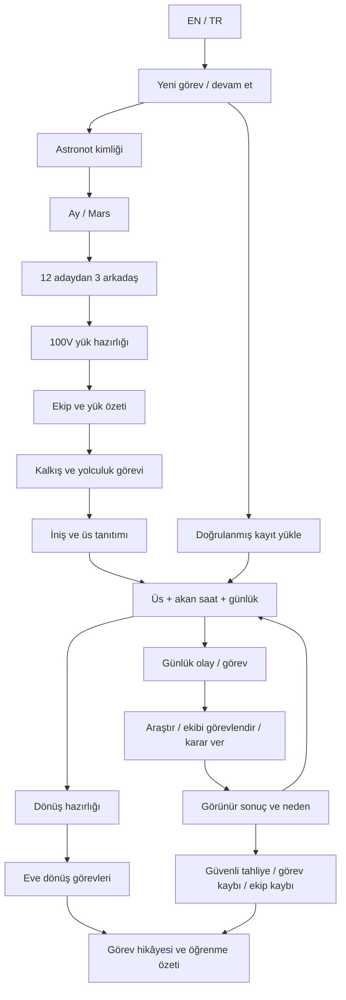

# Kullanıcı ve ekran akışı

Güncel kapsam: [Başlangıç belgesi](archive/00_START_HERE.md). Metinler örnektir; EN/TR karşılıkları içerik dosyalarına taşınır.

Diyagramdaki devam et düğümü kavramsaldır: kayıt hangi aşamada ise oraya dönülür; hazırlık veya yolculuk kaydı doğrudan yüzey ekranına atlamaz.

## 01 — Dil ve giriş

- Açılışta English / Türkçe seçimi; tercih cihazda saklanır. Sonradan değiştirilebilir.
- Özgün 2D gezegen/gemi sahnesi, kısa ürün cümlesi, yeni görev ve geçerli kayıt varsa devam et.
- Tam görev hedefi ile mevcut demo süresi ayrı etiketlenir. Sessiz başlangıç; ses kullanıcı açarsa başlar.
- Yeni görev mevcut kaydı değiştirecekse açık uyarı; geçerli kayıt sessizce silinmez.

## 02 — Astronot kimliği

- Yeni görev seed'i ile rastgele portre, geçmiş, üç ana yetenek ve profil bilgileri üretilir.
- İsim isteğe bağlı; boş/boşluk girilirse dile uygun isim atanır. Metin HTML olarak çalıştırılmaz.
- Boy ve kilo profil detayı olabilir; varsayılan olarak ölüm şansı veya ahlaki/değer sıralaması üretmez.
- Her yetenek için “Neyi etkiler?” açıklaması. Profil üretimi ile yeniden isim verme ayrıdır; isim değişikliği yetenekleri tekrar çekmez.
- Hazırlık sırasında açık bir “Yeni profil” eylemi seed/profil yeniler; geriye dönmek kendi başına yenilemez.

## 03 — Hedef seçimi

- Ay ve Mars için büyük görsel kartlar: çevre, beklenen güçlük ve görev atmosferi.
- Ay: hava basıncı/termal yönetim, aydınlanma ve koruma konuları. Mars: toz, enerji ve bakım konuları. Ayrıntılı katsayılar doğrulanır.
- Her iki hedef ilk demoda gerçek bir olay setiyle oynanabilir; aynı olayın yalnız başlığını değiştirmek yetmez.
- Hedefi hazırlıkta değiştirmek seçili ekip ve envanteri koruyabilir; uyumsuz eşya varsa nedenini gösterip kalkışı engeller.

## 04 — Ekip seçimi

- Varsayılan 12 adaydan tam üçü seçilir; oyuncuyla toplam dört kişi.
- Portre, isim, kısa geçmiş, üç etiketli bar: Teknik / Bilim / Ekip uyumu.
- Hover, tıklama, dokunma ve klavye odağında aynı ayrıntı açılır. Renk dışında etiket ve değer bulunur.
- İsim değiştirilebilir; adayın ID'si sabittir. Aynı kişi iki kez seçilemez.
- Seçim özeti ekibin güçlü yanlarını ve eksiklerini açıklar. Eksik uzmanlık uyarıdır; otomatik başarısızlık değildir.

## 05 — Yük hazırlığı

- Görsel 100V yük ızgarası, kategorilere ayrılmış eşyalar, miktar ve çıkarma kontrolü.
- Her eşya: V maliyeti, kullanım amacı, tüketilebilirlik ve açtığı seçenek.
- 100V üstünde kalkış engellenir. Daha az yükle gitmek mümkündür; kritik eksikler anlaşılır uyarı verir.
- Hedefte başlangıç üssünün neleri sağladığı açıkça yazılır; 100V bütün üssü kurma zorunluluğu değildir.
- İsim/ekip/yük düzenlemeleri sayfalar arasında korunur. Henüz kullanılmamış eşya stoktan düşmez.

## 06 — Brifing ve kalkış

- Tek ekranda hedef, dört kişi, yük ve görev amacı; önceki ekranlara düzenleme bağlantıları.
- “Kalkış” hazırlığı dondurur ve başlangıç kaydı oluşturur. Çift tıklama iki görev başlatmaz.
- Kısa geçilebilir 2D kalkış; ardından bir gerçek karar: örneğin enerji bütçesi ile ek kontrol arasında seçim.
- Yolculuk zamanı ayrı, sıkıştırılmış bölüm olarak anlatılır; Mars'a gerçek uçuşun 30 gün sürdüğü söylenmez.

## 07 — Üs, olay ve araştırma

- Üstte görev zamanı, hedef, hız/duraklat ve durum; merkezde yaşayan 2D üs; kenarlarda ekip ve kısa günlük.
- Enerji/batarya, O₂, su, gıda, korunma ve ekip sağlığı okunabilir. Açılan ayrıntı hesap nedenini gösterir.
- Oyun günü başına hedef 1–2 anlamlı olay/seçim. Rutin küçük olaylar ile büyük krizler dönüşümlü.
- Olay kartı: durum → bilinenler → seçenekler → ekip/eşya gereksinimi → süre/maliyet → risk → karar.
- Araştırma, aynı karttan açılır; kısa bilgi, kaynak bağlantısı ve mevcut karara etkisi vardır.
- Seçimden sonra görsel durum, kaynaklar, karakter tepkisi ve nedensel günlük birlikte güncellenir.

## 08 — Zaman davranışı

- Önerilen varsayılan: aktif oyunda 60 gerçek saniye = 1 görev günü; tam oyun yaklaşık 30 aktif dakika + hazırlık/karar süreleri.
- Saat her zaman görünür; kritik karar ve araştırma sırasında durduysa “Karar için duraklatıldı” yazılır. Oyuncu duraklatma önerisini isterse tasarımda değiştirebilir.
- Arka plan sekmesi, kapalı tarayıcı ve kayıt yükleme zamanı ilerletmez. Oyun aktif dikkat dışında ekip öldürmez.
- Hızlandırma yalnız simülasyon zamanını etkiler; aynı eşik tekrar olay üretmez. Hız değiştirirken aktif işlemler korunur.
- Ay/Mars ekranında ortak “görev günü” sayacı kullanılır; gezegenin fiziksel gün uzunluğuyla birebir eşitlik iddia edilmez.

## 09 — Dönüş ve sonuç

- Gün hedefi tek başına zafer değildir: aktif ekip, yeterli dönüş rezervi ve zorunlu hazırlık işleri kontrol edilir.
- Dönüşte en az iki kısa görev: rezerv tahsisi ve arıza/ekip koordinasyonu. Önceki yük, aşınma ve ekip durumu sonucu etkiler.
- Sonuç: geri dönenler, kayıplar, üç önemli karar, hazırlığın etkisi ve öğrenilen ilişkiler.
- Seed ile yeniden dene yeni görev oluşturur; geçmiş tamamlanmış görev özeti ayrı tutulabilir.
- Kısmi başarı mümkündür. Ekip kaybı sessizce “tam başarı” sayılmaz. Oyuncu karakteri kaybedilirse ilk sürümde görev sonlandırılır; sonraki komutan sistemi sonraki kapsamdır.
